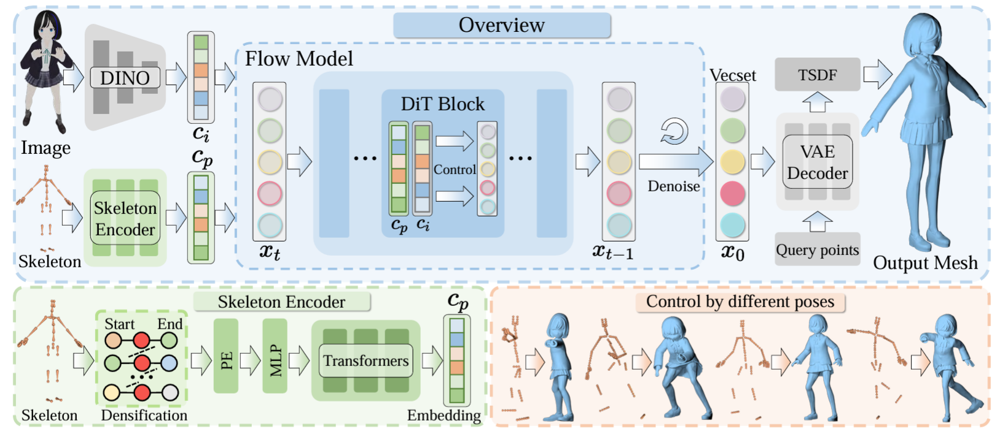

<h2 align="center">PoseMaster: A Unified 3D Native Framework for Stylized Pose Generation</h2>
<h4 align="center">CVPR 2026</h4>
<p align="center">Hongyu Yan, Kunming Luo, Weiyu Li, Kaiyi Zhang, Yixun Liang, Jingwei Huang, Chunchao Guo, Ping Tan</p>

<p align="center">
  <a href="https://arxiv.org/abs/2506.21076"></a>
  <a href="https://huggingface.co/HanryYAN/PoseMaster"></a>
  <a href="https://github.com/hanryyan/PoseMaster"></a>
  <a href="LICENSE"></a>
</p>

## News

- Training and inference code are now available.
- PoseMaster is accepted to CVPR 2026.

## Introduction

This repository is the official implementation of **PoseMaster: A Unified 3D Native Framework for Stylized Pose Generation (CVPR 2026)**.

PoseMaster unifies pose stylization and 3D generation in a cohesive 3D-native framework. Instead of using 2D skeleton images as guidance, it directly conditions generation on **3D skeletons** to better capture spatial and topological relationships. We also build a scalable data engine for constructing large-scale **Image-Skeleton-Mesh** triplets, enabling joint learning of identity preservation and geometric alignment. The strict alignment between generated meshes and conditioning skeletons makes PoseMaster suitable for producing animatable assets when combined with automated skinning models.

<p align="center">
  
</p>

## Installation

```bash
git clone https://github.com/hanryyan/PoseMaster
cd PoseMaster
conda create -n posemaster python=3.11.0
conda activate posemaster
pip install torch==2.5.1 torchvision==0.20.1 torchaudio==2.5.1 --index-url https://download.pytorch.org/whl/cu118
pip install -r docker/requirements.txt
```

## Pretrained Models

Download the PoseMaster checkpoints and DINOv2-Large, then arrange them as follows:

```text
ckpts/
├── posemaster_vae.ckpt
├── posemaster_cond.ckpt
├── posemaster_dit.ckpt
└── dinov2-large/
    ├── config.json
    ├── preprocessor_config.json
    └── model.safetensors
```

| Model | Download |
| :--- | :--- |
| PoseMaster (VAE, condition encoder, and DiT) | [Hugging Face](https://huggingface.co/HanryYAN/PoseMaster) |
| DINOv2-Large | [Hugging Face](https://huggingface.co/facebook/dinov2-large) |

The paths above match the defaults in `configs/shape-diffusion/shape-diff-hunyuan3d-bone-query-256-lr1e5-freeze-skeleton.yaml`.

## Training

The example training configuration reads the three datasets under `data/playbox`, `data/readyplayerme`, and `data/vroid`. Prepare the data and update the dataset JSON files before launching training. Example data and JSON manifests are included under `data/` to illustrate the expected layout.

Run training on GPU 0:

```bash
python train.py --config configs/shape-diffusion/shape-diff-hunyuan3d-bone-query-256-lr1e5-freeze-skeleton.yaml --train --gpu 0
```

Training outputs and checkpoints are written under `outputs/image-skeleton-to-shape-diffusion/` according to the experiment configuration.

## Inference

Run inference with the released PoseMaster DiT checkpoint:

```bash
python inference.py --config_path configs/shape-diffusion/shape-diff-hunyuan3d-bone-query-256-lr1e5-freeze-skeleton.yaml --ckpt_path ckpts/posemaster_dit.ckpt --save_dir val_data/infrence_results --data_json val_data/val_data.json
```

For each input pair, inference saves:

- a generated mesh in GLB format;
- the normalized skeleton points in PLY format;
- the processed conditioning image in PNG format.

### Build a Custom Test Set

Place your images and skeleton files anywhere in the repository, then describe the image-skeleton pairs in a JSON file. The JSON must contain two arrays named `image` and `skeleton`:

```json
{
  "image": [
    "val_data/custom/images/character_01.png",
    "val_data/custom/images/character_02.png"
  ],
  "skeleton": [
    "val_data/custom/skeletons/pose_01_bone_points.pkl",
    "val_data/custom/skeletons/pose_02_bone_points.pkl"
  ]
}
```

Follow these requirements when editing `val_data/val_data.json` or creating a new manifest:

1. `image` and `skeleton` must have the same number of entries.
2. Entries at the same index form one inference pair. Repeating an image with different skeleton paths generates the same character in different poses.
3. Use paths relative to the repository root, or valid absolute paths.
4. Each skeleton file must be readable by NumPy with `allow_pickle=True` and contain a `body` field. Optional `lefthand` and `righthand` fields are also supported.
5. A skeleton filename ending in `bone_points.pkl` may be accompanied by a `geometry.npz` file in the same directory. The geometry file should contain `center` and `scale` values for consistent normalization. If it is absent, PoseMaster normalizes the skeleton using its bounding box.

Pass a custom manifest through `--data_json`:

```bash
python inference.py   --config_path configs/shape-diffusion/shape-diff-hunyuan3d-bone-query-256-lr1e5-freeze-skeleton.yaml   --ckpt_path ckpts/posemaster_dit.ckpt   --save_dir val_data/custom_results   --data_json val_data/custom_val_data.json
```

## TODO

- [x] Training code
- [x] Inference code
- [x] Model checkpoints
- [ ] Gradio and Hugging Face demo
- [ ] Data processing and rendering pipeline

## Citation

If you find this project useful, please cite:

```bibtex
@inproceedings{yan2026posemaster,
  title={PoseMaster: A Unified 3D Native Framework for Stylized Pose Generation},
  author={Yan, Hongyu and Luo, Kunming and Li, Weiyu and Zhang, Kaiyi and Liang, Yixun and Huang, Jingwei and Guo, Chunchao and Tan, Ping},
  booktitle={Proceedings of the IEEE/CVF Conference on Computer Vision and Pattern Recognition},
  pages={34292--34302},
  year={2026}
}
```
